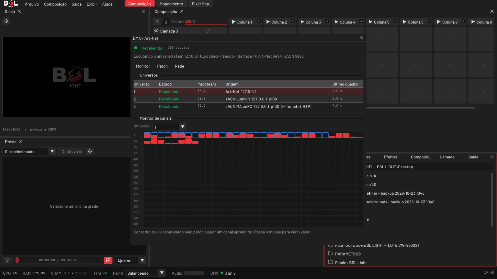
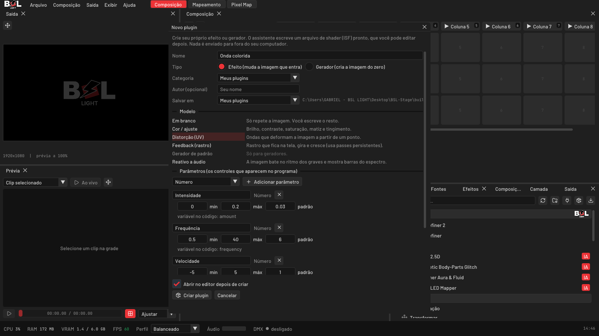
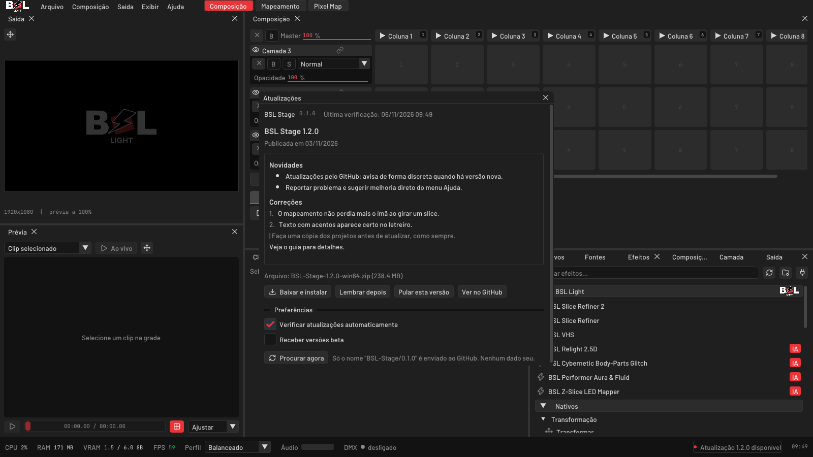
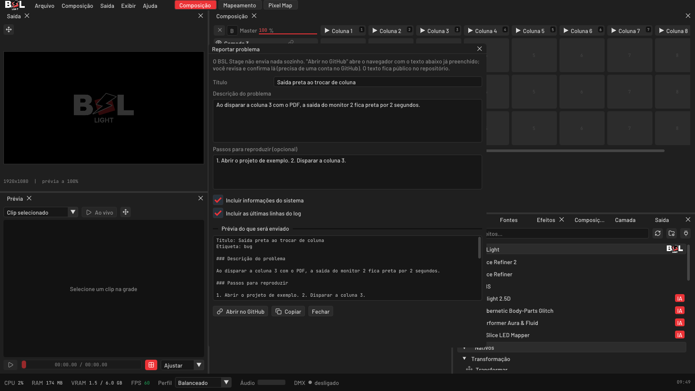
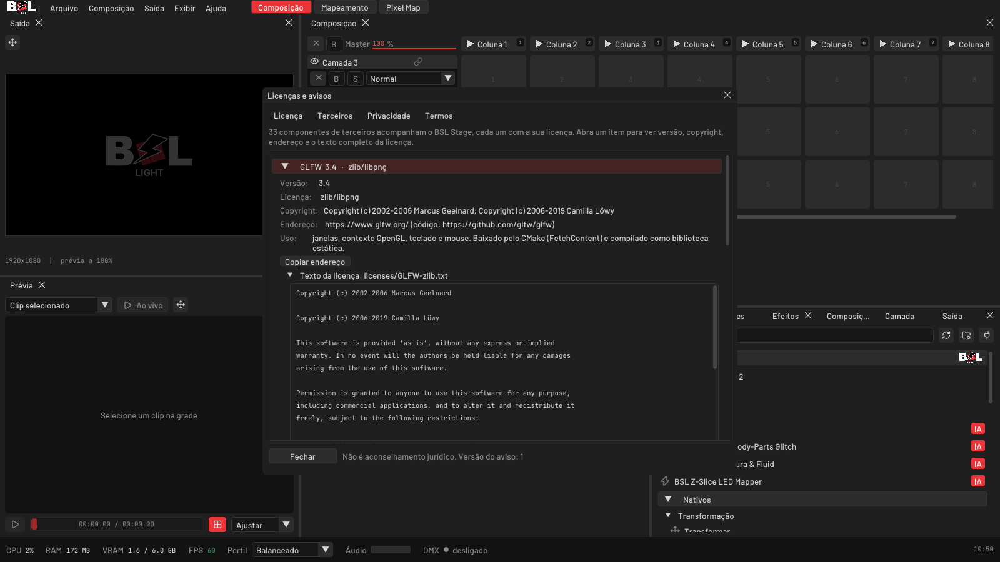

# BSL Stage

Software de VJ / mapping / painel LED, gratuito e open source (GPL-3.0), em C++20 com OpenGL 3.3.
Veja `docs/ARQUITETURA.md` (como funciona), `docs/ROADMAP.md` (fases) e `docs/Melhorias.md` (pedidos).

## O que faz

- Grade de clips, camadas, blend modes, Transform, efeitos nativos, ISF e plugins FFGL, mídia (vídeo, imagem, PDF, Office, Web),
  Spout e NDI, Stream de rede (RTMP, RTSP, SRT, UDP, HLS: puxar um link ou receber um envio; `docs/STREAM.md`), saídas por monitor com mapping (slices, warp, soft edge) e Pixel Map para painéis de LED.
- Atalhos de teclado personalizáveis (Exibir > Atalhos).
- **DMX / Art-Net**: uma mesa ou software de luz controla o BSL Stage por **Art-Net e sACN**. Cada camada vira um fixture
  (opacidade, clip por faixa de valor, velocidade, blend, posição/escala/rotação em 8 ou 16 bits, efeitos), o master tem opacidade e blackout, e
  qualquer parâmetro pode ser aprendido (botão direito, "Atribuir DMX…", mexer o fader). Os perfis são exportados em GDTF e em tabelas
  CSV/HTML. Menu **Saída > DMX / Art-Net…**. Guia: `docs/DMX.md`.



## Plugins

O cliente cria o próprio plugin do jeito que quiser. Os dois caminhos usam **padrões abertos**: shaders **ISF** (um arquivo `.fs`, o caminho fácil) e plugins **FFGL 2.x** (DLL em C++). Qualquer shader ISF e qualquer plugin FFGL 2.x de 64 bits que
respeite o padrão funciona; o BSL Stage não copia nem redistribui plugins de terceiros.

- **Novo plugin…** (menu **Arquivo** e aba **Efeitos**): o assistente pede nome, tipo (efeito ou gerador), categoria, modelo (em branco, cor/ajuste, distorção, feedback com passes persistentes, padrão, reativo a áudio) e os parâmetros
  (número, cor, liga/desliga, ponto 2D, imagem, botão, áudio) e grava um `.fs` válido em `Documents\BSL Stage\Plugins`. Ele aparece na hora na aba Efeitos.
- **Recarga automática**: salvou o arquivo no editor, o efeito recompila sozinho, sem reiniciar e sem perder os valores. Erro de compilação aparece no painel do efeito com a linha certa e a versão anterior continua rodando.
- **Abrir no editor**, **Mostrar na pasta** e **Duplicar** no efeito; **Exportar** e **Importar `.bslplugin`** (ZIP com o shader, as imagens e um `manifest.json` com nome, autor, versão e licença; a importação valida o conteúdo e mostra a licença antes de instalar).
- **`bslstage_isfcheck <arquivo.fs>`**: valida um shader com o mesmo leitor e host do programa, mostra os erros com a linha e salva uma prévia (`--png out.png --time 1.5`).
- **C++**: `sdk/ffgl-template/` é um plugin FFGL 2.x completo para copiar e compilar.
- **Documentação**: `docs/plugins/` (visão geral, guia e referência do ISF, guia FFGL, boas práticas, licenças) e, para IAs, `AGENTS.md`, `docs/plugins/PARA-IA.md` e a skill `skills/bsl-stage-plugin/` (como instalar: `skills/README.md`).



## Atualizações e reportes

O BSL Stage se atualiza pelo **GitHub Releases** e recebe reportes pelo **GitHub Issues**, sem servidor próprio, conta nem token no programa.

- **Atualização discreta.** Uma vez por dia, em segundo plano, o programa pergunta ao GitHub se há versão nova. Nunca durante o show (saída ligada, tela cheia,
  layout bloqueado ou perfil Eco) e sem internet não acontece nada. Havendo versão nova, só aparece um pontinho na barra de status ("Atualização 1.2.0
  disponível") e um item em **Ajuda**; sem pop-up. O clique abre as notas da versão com **Baixar e instalar**, **Lembrar depois** e **Pular esta versão**.
  O download é conferido pelo SHA-256 do release; a instalação acontece quando você fechar o programa (ou em "Reiniciar agora", se nada estiver tocando),
  guarda a versão anterior e **volta atrás sozinha se algo falhar**. Projetos e configurações nunca são tocados.
  **Ajuda > Procurar atualizações…** faz a verificação na hora e tem as opções "Verificar atualizações automaticamente" (ligada) e "Receber versões beta" (desligada).
- **Reportar problema / Sugerir melhoria** (menu **Ajuda**): uma janela com título, descrição e passos; as caixas "informações do sistema" e "últimas linhas do log"
  vêm desmarcadas e a prévia mostra exatamente o texto que será enviado. **Abrir no GitHub** abre o navegador com o texto já preenchido e você confirma lá;
  **Copiar** copia o texto. O programa não envia nada sozinho.
- **Privacidade.** A única coisa enviada ao GitHub nas atualizações é o cabeçalho `User-Agent: BSL-Stage/<versão>`. Nenhum dado do usuário, cookie ou token.
- Repositório configurável em um lugar só (`BSLSTAGE_GITHUB_REPO`, hoje o provisório `bsl-light/bsl-stage`). Como publicar uma versão: `docs/RELEASE.md`.




## Como compilar (Windows 11)

Requisitos: Visual Studio (C++), CMake 3.25+ e Git. As dependências (GLFW, Dear ImGui, nlohmann/json, FFmpeg, PDFium...) são baixadas
pelo CMake. O loader OpenGL (glad) já está em `third_party/glad`.

```
cmake --preset windows
cmake --build --preset release
build\Release\BSLStage.exe
```

O build usa `/W4` e precisa terminar sem avisos. As configurações ficam em `%APPDATA%\BSL Stage\settings.json`.

## Testes

Os executáveis de teste ficam em `build\Release`, com o prefixo `bslstage_`. Rode da raiz do projeto:

```
build\Release\bslstage_mediatest.exe testmedia      # decodificação (gerar a mídia: bash tools/make_testmedia.sh testmedia)
build\Release\bslstage_projecttest.exe              # .bslstage (inclui o DMX e a migração de projeto antigo)
build\Release\bslstage_keystest.exe                 # atalhos e ações
build\Release\bslstage_dmxtest.exe                  # DMX: pacotes, mistura, receptor por loopback, patch, learn, exportação
build\Release\bslstage_updatetest.exe               # atualizações e reportes: semver, release do GitHub, SHA-256, ZIP, atualizador com backup/rollback (sem rede)
build\Release\bslstage_uitest.exe                   # layouts, menu Exibir e os avisos legais (THIRD-PARTY-NOTICES.md x CMake, licenses/, aceite do aviso)
build\Release\bslstage_plugintest.exe               # Novo plugin: modelos, recarga automática, .bslplugin (ida e volta e pacotes maliciosos), exemplos dos documentos
build\Release\bslstage_transformtest.exe, ...       # fxtest, bsltest, maptest, pixelmaptest, doctest, livetest, spouttest, ffgltest, aitest
build\Release\bslstage_streamtest.exe               # Stream de rede: receber/puxar RTMP, SRT e UDP, queda e reconexão, parada rápida, erros, projeto (só 127.0.0.1)
build\Release\bslstage_ndittest.exe --ndi-lib "<pasta do NDI Runtime>\Processing.NDI.Lib.x64.dll"
python tools/uiqa/run.py --config window            # teste de interface com mouse e teclado reais (tools/uiqa/README.md)
```

O `bslstage_dmxtest` usa só o loopback (`127.0.0.1`): não abre portas para a rede nem aciona o Firewall. O multicast sACN real
só é testado com `--multicast`.

## Regenerar o glad

```
pip install glad2
glad --api gl:core=3.3 --out-path third_party/glad c
```

## Licença, privacidade e termos

O BSL Stage é **software livre, sem garantia**, © 2026 BSL Light, sob a **GNU GPL versão 3 (GPL-3.0)**: você pode usar (inclusive
comercialmente), estudar, modificar e compartilhar, e quem distribui o programa precisa oferecer o código-fonte. Não há EULA proprietário.

- `LICENSE`: o texto completo da GPL-3.0.
- `THIRD-PARTY-NOTICES.md` e `licenses/`: o software de terceiros que acompanha o programa (GLFW, Dear ImGui, FFmpeg, PDFium, CEF, ONNX Runtime,
  DirectML, modelos de IA, fontes, o bundle web do WebBackgrounds...), com versão, licença, copyright, endereço e o texto de cada licença. O que ainda
  não pôde ser verificado está marcado como **PENDENTE** (decisões jurídicas ficam para quem responde pelo projeto).
- `PRIVACIDADE.md`: funciona offline, sem telemetria; a única conexão automática é a busca de atualização no GitHub (uma vez por dia, dá para desligar).
- `TERMOS-DE-USO.md`: resumo da GPL-3.0 em linguagem simples, aviso "sem garantia" (GPL-3.0, seções 15 e 16), uso da marca BSL Light/BSL Stage (os nomes e o logo
  não são cobertos pela GPL), patentes (H.264/HEVC) e a marca NDI (Vizrt). **Não é aconselhamento jurídico: revisar com advogado antes da 1.0.**

No programa: **Ajuda > Licenças e avisos…** (abas Licença, Terceiros, Privacidade e Termos, lidas dos arquivos acima), **Ajuda > Sobre** (copyright, GPL-3.0 e o
link do código-fonte). O aviso de instalação fica no instalador, não no programa. O pacote `.zip` traz todos
esses arquivos ao lado do executável (ver `docs/RELEASE.md`).


