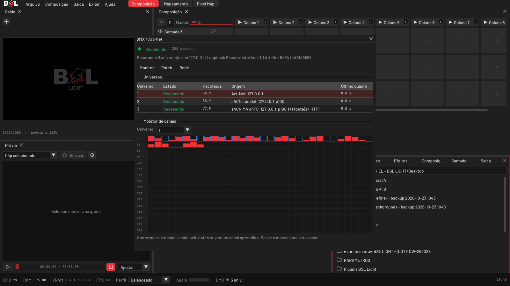

# DMX / Art-Net: controlar o BSL Stage por uma mesa de luz ou software de luz

O BSL Stage **recebe** DMX por **Art-Net** e **sACN (E1.31)**. A mesa (ou o software de luz) trata cada camada como um fixture: o
fader de opacidade, o disparo de clips, a velocidade, o blend, a posição/escala/rotação e os efeitos viram canais DMX.
Também dá para **aprender** qualquer parâmetro: botão direito, "Atribuir DMX…" e mexer o fader.

> Nesta versão o BSL Stage só **recebe** DMX. A saída Art-Net/sACN (por exemplo, o mapa de pixels para uma processadora de LED)
> ainda não existe.

## 1. Ligar o receptor

Menu **Saída > DMX / Art-Net…** (ou clique no indicador **DMX** da barra de status), aba **Rede**:

1. Marque **Receber DMX**. Vem **desligado** por padrão: ao ligar pela primeira vez o Windows pode perguntar sobre o
   Firewall. Permita em **rede privada**.
2. **Placa de rede**: escolha a placa que está na mesma rede da mesa (ex.: `Ethernet  192.168.0.10`). "Todas as placas"
   também funciona. Só pacotes vindos da mesma sub-rede da placa escolhida são aceitos.
3. **Universos**: quais universos escutar (`1-4`, `1-4, 10`). Os universos usados pelo patch entram sozinhos.
4. **Protocolos**: Art-Net (UDP 6454) e sACN (UDP 5568, com multicast por universo `239.255.x.y`). Pode usar os dois.
5. **Duas fontes no mesmo universo**: **HTP** (maior valor por canal) ou **LTP** (quem mexeu por último). No sACN vence a fonte
   de maior **prioridade**; o Art-Net não tem prioridade e conta como a prioridade configurada (100).
6. **Perda de sinal** (padrão 2,5 s): **Manter o último valor** (cabo solto não apaga o show) ou **Soltar** (o patch volta ao
   valor neutro de cada canal: opacidade 0, velocidade 1x, posição no centro...).

**Numeração dos universos.** O BSL Stage usa a numeração do sACN: **Universo 1**. No Art-Net o primeiro universo é o **0**, então
`Universo 1 = Art-Net 0`. Se a sua mesa conta o Art-Net a partir de 1, mude em "Universo 1 no Art-Net é o" para "Art-Net 1".

O programa aparece como **"BSL Stage"** na lista de nós Art-Net da mesa ou do software de luz (responde ao ArtPoll). Na aba **Monitor**
você vê, por universo, o estado, os pacotes por segundo, a origem (nome, IP, prioridade), o último quadro e os 512 canais.

## 2. Patch: as camadas como fixtures

Aba **Patch**. Clique em **Patch automático** (um fixture por camada e um para o Master, em sequência a partir do universo 1) ou em
**+ Camada** / **+ Master**. Em cada linha: a camada, a **personalidade**, o universo e o endereço inicial. A camada é guardada
pelo **id estável**: reordenar ou apagar camadas não desloca o patch. O patch é salvo no projeto (`.bslstage`); projetos antigos
abrem sem patch.

### Personalidades de camada

| Canal | Básico (2) | Padrão (4) | Completo (8) | Completo 16 bits (12) | Função |
|---|---|---|---|---|---|
| 1 | Opacidade | Opacidade | Opacidade | Opacidade | 0-255 = 0-100% |
| 2 | Clip | Clip | Clip | Clip | faixas de 10: 0-9 nada, 10-19 limpar camada, 20-29 coluna 1, 30-39 coluna 2 ... até a coluna 24 |
| 3 | | Velocidade | Velocidade | Velocidade | 0 = parado, 128 = 1x, 255 = 4x |
| 4 | | Blend | Blend | Blend | faixas de 28: Normal, Adicionar, Subtrair, Multiplicar, Tela, Sobrepor, Clarear, Escurecer, Diferença |
| 5 (5-6) | | | Posição X | Posição X | metade = centro; 0 = canvas inteiro para a esquerda; máximo = para a direita |
| 6 (7-8) | | | Posição Y | Posição Y | idem, para cima/baixo |
| 7 (9-10) | | | Escala | Escala | 0 = 0%, metade = 100%, máximo = 400% |
| 8 (11-12) | | | Rotação | Rotação | metade = 0°, 0 = -180°, máximo = +180° |
| + n | Efeito 1..n | | | | opcionais (até 16): cada um comanda um parâmetro de um efeito da camada (botão **+ FX** da linha) |

No **16 bits** cada função de transform usa dois canais (grosso + fino), então os números entre parênteses são os dois canais.
Os valores neutros (padrão do fixture) são o meio (128 ou 32768).

O canal de **Clip dispara quando entra na faixa**. Para disparar o mesmo clip de novo, passe pela faixa 0-9. Ao abrir o projeto
com a mesa já numa faixa, nada dispara (o primeiro valor visto é só o ponto de partida).

### Master (3 canais)

| Canal | Função |
|---|---|
| 1 | Opacidade do master (0-255) |
| 2 | Blackout (0-127 normal, 128-255 blackout) |
| 3 | Coluna global: 0-9 nada, 10-19 limpar tudo, 20-29 coluna 1, 30-39 coluna 2 ... |

Um valor só é aplicado quando o canal **muda**: mexer na interface do BSL Stage vale até a mesa mexer de novo naquele canal.

## 3. Exportar os perfis para a mesa ou o software de luz

Aba **Patch > Exportar perfis…** e escolha uma pasta. É criada a pasta `BSL Stage DMX` com:

| Pasta | Conteúdo |
|---|---|
| `GDTF\` | `BSL Light@BSL Stage Layer@v1.gdtf` e `BSL Light@BSL Stage Master@v1.gdtf` (GDTF, padrão aberto DIN SPEC 15800) |
| `Tabelas\` | `canais.csv`, `patch.csv`, `canais.html` (tabela de canais; abra no navegador e use Imprimir > Salvar como PDF) e um `LEIA-ME.txt` |

Cada fixture traz os modos Básico, Padrão, Completo e Completo 16 bits, mais os modos com canais de efeito usados no seu patch.

### Pelo GDTF

1. Copie os `.gdtf` para a pasta de tipos de fixture da mesa ou do software de luz (ou por pendrive) e importe-os.
2. No patch, adicione "BSL Stage Layer" (um por camada, no **modo** igual ao da linha do BSL Stage) e "BSL Stage Master", com o
   universo e o endereço do patch do BSL Stage.
3. Ligue a saída **Art-Net** ou **sACN** na placa de rede do PC/mesa e deixe a saída do universo ativa.
4. No BSL Stage ligue o receptor na mesma rede. O nó "BSL Stage" aparece na lista de nós Art-Net.

### Pelas tabelas

Se a mesa ou o software não importar GDTF, crie o tipo de fixture no editor deles seguindo `canais.csv` (um canal por linha; as funções
de cada faixa estão na coluna "Função"). Depois faça o patch com o universo e o endereço de `patch.csv` e ligue a saída **Art-Net**
(ou sACN) do universo para o IP da placa de rede do BSL Stage.

### Software de luz no mesmo computador

Os dois programas podem escutar a mesma porta (o BSL Stage usa reuso de porta), mas o **unicast** só chega a um deles. Prefira **sACN** (multicast
chega nos dois) ou rode o BSL Stage em outro computador. Se o Art-Net não chegar, escolha em **Placa de rede** a mesma placa
que o outro programa usa.

## 4. DMX learn (qualquer parâmetro)

1. **Botão direito** num parâmetro: opacidade da camada ou do master, blend, velocidade, posição, escala, rotação, qualquer
   parâmetro de efeito (clip, camada ou master). Também numa **célula**, **coluna**, **camada** (ligar/desligar) ou no olho de um efeito.
2. **Atribuir DMX…**. Aparece "Mexa o fader na mesa".
3. Mexa o fader (o primeiro canal que andar mais de 4 passos é o escolhido). O canal e o universo ficam ligados ao parâmetro.

Nas ações (célula, coluna, camada, efeito, blackout...) o canal **dispara ao cruzar o limiar** (padrão 128) para cima, como a
tecla. Nas que alternam existe o modo **Seguir**: liga enquanto o canal está acima do limiar e desfaz ao descer. Os canais
aprendidos aparecem na aba **Patch** (universo, canal, 16 bits, limiar, inverter, remover) e usam as mesmas ações dos atalhos de
teclado. O canal aprendido só se move quando o canal DMX muda.

## 5. Problemas comuns

| Sintoma | O que fazer |
|---|---|
| "Não foi possível abrir as portas" | Outro programa usa a porta 6454/5568 sem permitir compartilhar. Feche-o ou use só um dos protocolos. |
| O Windows perguntou do Firewall | Permita em rede privada. Sem isso, broadcast e multicast não chegam. |
| Status "Aguardando dados" | Confira a placa de rede (mesma sub-rede da mesa), o universo e se a saída Art-Net/sACN da mesa está ligada. |
| Universo 1 recebe o que a mesa chama de 0 | Veja a numeração (seção 1). |
| sACN multicast com muitos universos | O Windows limita as inscrições por socket; o BSL Stage divide em sockets de 16. O aviso aparece na aba Monitor. |
| A mesa não mostra o BSL Stage na lista de nós | O ArtPoll chega por broadcast: a placa escolhida precisa estar na rede da mesa. A mesa ou o software podem exigir "atualizar nós". |

## 6. Para quem for mexer no código

Núcleo sem GL nem ImGui em `src/dmx/` (`DmxProtocol`, `DmxMerge`, `DmxNet`, `DmxMap`, `DmxEngine`, `DmxService`, `DmxExport`), janela em
`src/ui/panels/DmxWindow.*` e teste `bslstage_dmxtest`. Detalhes em `docs/ARQUITETURA.md`.
