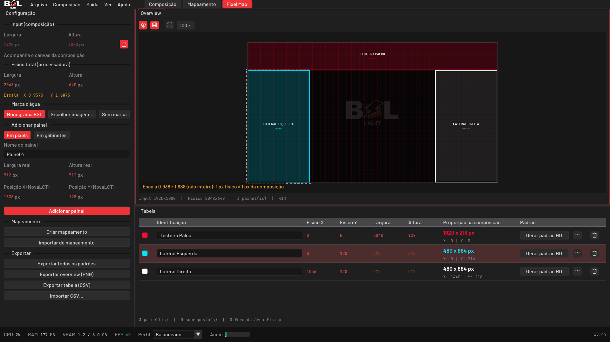

# Pixel Map

O terceiro modo do topo (**Composição | Mapeamento | Pixel Map**) traz para dentro do BSL Stage a ferramenta HTML
"BSL Light Pixel Mapping Pro" (referência fiel em `docs/referencia/pixel-mapping-pro.html`), com incrementos.

## O que faz

- **Configuração** (esquerda): input (largura e altura da composição, **ligado ao canvas** por padrão, cadeado para
  liberar), físico total (resolução da processadora / NovaLCT), marca d'água (monograma BSL, "Escolher imagem…" ou "Sem
  marca") e "Adicionar painel". Os painéis são definidos **em pixels** (largura, altura, X, Y) ou **por gabinetes**
  (colunas × linhas × px do gabinete, como no LEDMapperPro).
- **Overview** (centro): mapa ao vivo da composição com grade, marca d'água e os painéis coloridos com nome e `WxH`.
  Clique seleciona, arrastar move com o **ímã** (`Snap`, em coordenadas físicas: encaixa nas bordas, cantos e centros dos
  outros painéis e da área física; Alt desliga), roda = zoom no cursor, botão do meio ou arrastar o vazio = pan, setas
  (Shift = 10 px), Delete e Esc.
- **Tabela** (embaixo): identificação, físico (X, Y, largura, altura), proporção na composição (`W x H`, `X`, `Y`),
  "Gerar padrão HD" (PNG na resolução física, com diálogo), remover e edição inline com números arrastáveis. O botão `⋯`
  abre gabinetes e cor do painel; clicar no quadrado de cor passa para a próxima da paleta do HTML (vermelho BSL, ciano,
  branco, âmbar).

A escala é a do HTML: `res = físico × (input / físico total)` com `Math.round` (meio arredonda para cima).
Exemplo (input 1920×1080, físico 2048×640): "Testeira Palco" 2048×128 em (0,0) vira 1920×216 em (0,0).

## Incrementos

- **Criar mapeamento**: cria ou atualiza uma Screen com a resolução física total e um Slice por painel (entrada = o
  retângulo escalado no canvas, saída = a posição física). Pergunta se substitui a tela selecionada ou adiciona uma nova e
  entra no histórico de desfazer do Mapeamento.
- **Importar do mapeamento**: o inverso (um painel por slice, físico total = resolução da tela).
- **Fonte "Padrão de calibração BSL"** (aba Fontes, seção BSL Light): desenha ao vivo, no canvas, o padrão de cada painel
  no seu retângulo escalado. Com o mapeamento criado, o padrão certo aparece no painel físico real. Opcional: barra que
  corre e contador de quadros (frame drop e travamento) e filtro suave ou pixel mais próximo.
- **Exportar todos os padrões** (pasta com 1 PNG por painel), **Exportar overview** (PNG do tamanho do input) e
  **Exportar tabela** (CSV `nome;fisico_x;fisico_y;fisico_w;fisico_h;comp_x;comp_y;comp_w;comp_h`, UTF-8 com BOM, aceita `;`
  `,` e tab na leitura). **Importar CSV** no mesmo formato.
- **Validações visuais**: sobreposição em âmbar, painel fora da área física em vermelho (tracejado) e aviso discreto quando a
  escala não é inteira ("1 px físico ≠ 1 px da composição"). Escala "limpa" = 1:1, múltiplo inteiro (2×, 3×…) ou divisor
  inteiro (½, ⅓…).
- **Persistência**: a configuração vai no `.bslstage` (chave `pixelMap`, aditiva: só é gravada quando algo foi mexido).

## Padrão HD

Mesmo desenho do HTML, na resolução física do painel: fundo radial escuro, grade de 10 e 50 px, círculos (sólido e
tracejado), cruz central, marcas nos cantos, xadrez 20×20 (1 px por casa) nas bordas, borda vermelha, barras RGBWK com
rampa (painéis com altura > 120 e largura > 300), caixa central com o logo, "BSL LIGHT PIXEL MAPPING", o nome, a resolução
física e a coordenada. Fontes: Barlow Bold no lugar da Rajdhani e JetBrains Mono no lugar do `monospace`; o logo é o
monograma BSL (`assets/brand`) ou a imagem escolhida.

## Código

| Arquivo | Papel |
|---|---|
| `src/output/PixelMap.{h,cpp}` | modelo, escala, validação, CSV (sem ImGui nem GL) |
| `src/output/PixelMapMapping.cpp` | Criar mapeamento / Importar do mapeamento (OutputSetup) |
| `src/output/PatternRaster.{h,cpp}` | desenho em CPU: padrão HD e overview, PNG |
| `src/fx/bsl/PixelMapSource.cpp`, `PixelMapFeed.h` | fonte ao vivo "Padrão de calibração BSL" |
| `src/ui/panels/PixelMapPanels.{h,cpp}` | os 3 painéis do modo |
| `tools/pixelmaptest.cpp` | `bslstage_pixelmaptest` (`--docs <pasta>` grava o padrão de exemplo) |
| `tools/uiqa/run.py` (cenário `pixelmap`), `tools/uiqa/pmshots.py` | teste de interface e screenshot |
