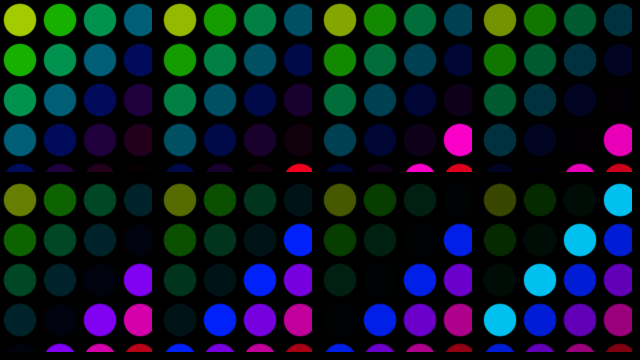
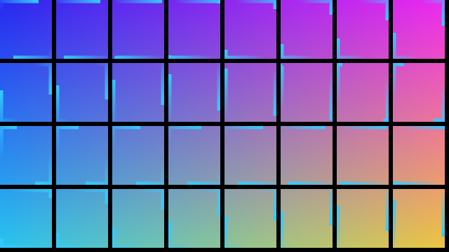
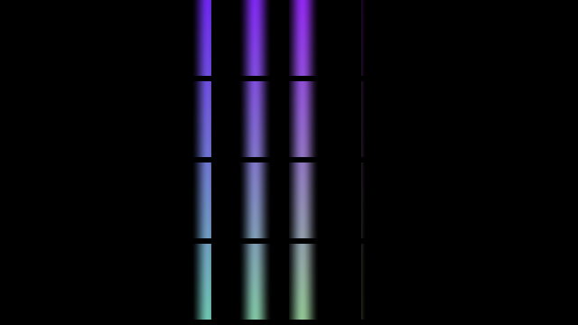
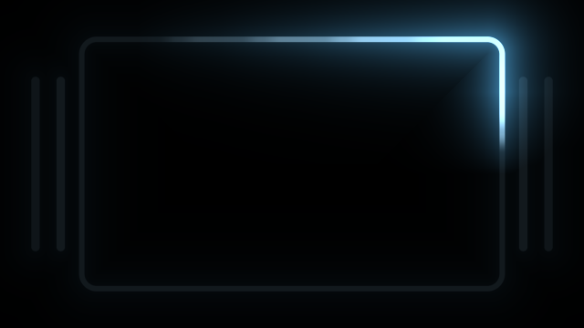
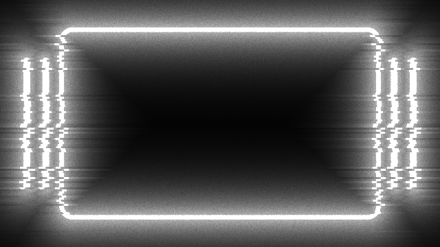
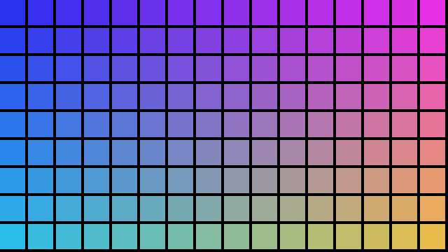

# Sequências de slices: guia do usuário

O modo **Sequências** acende os slices do Mapeamento passo a passo, como uma sequência de luzes, e tem efeitos próprios para cada slice (contorno, ladrilhos, borda neon, varredura...). Você desenha a sequência no Canvas, guarda os passos no projeto e usa os efeitos "Sequência de slices" e "Disparo manual" nas camadas ou no master.

## 1. Modo Sequências

Escolha **Sequências** no topo, ao lado de Composição, Mapeamento e Pixel Map. A tela tem:

- **Sequências e Visões** (esquerda): a lista de sequências e a lista de visões.
- **Canvas** (centro): os slices de todas as telas, pelo retângulo de entrada. Opcionalmente mostra a composição ao vivo atrás deles.
- **Passos** (embaixo): uma célula por passo.
- **Gerador** (direita) e **Envelopes** (aba ao lado do Gerador).

### Canvas

- **Zoom**: roda do mouse, Ctrl+`+` e Ctrl+`-`, ou **Ajustar à vista** (Ctrl+0).
- **Pan**: botão do meio, ou espaço + arrastar.
- **Ligar e desligar slices**:
  - clique inverte o slice;
  - arrastar um retângulo inverte os slices dentro dele;
  - Shift + retângulo liga;
  - Ctrl + retângulo desliga;
  - arrastar com o mouse (pincel) inverte cada slice uma só vez por gesto.
- **Alt** edita a Visão selecionada (veja a seção 2).
- **Fantasma**: mostra o contorno dos slices acesos no passo anterior.
- **Desfazer e refazer**: Ctrl+Z e Ctrl+Y. Cada gesto vira um passo de desfazer (limite de 32 MB).

### Passos

- Cada célula é um passo (1 a 1024). Clique para selecionar; as setas esquerda e direita mudam de passo.
- **+** e **-** adicionam e removem passos; a caixa numérica define o total. Alt + setas também funciona.
- Arrastar um passo sobre outro **copia** o estado. Ctrl + arrastar copia para cada k-ésimo passo seguinte.
- **Repetir** (→) copia o passo atual para todos os seguintes.
- **Vai e volta** (↔) acrescenta os passos em ordem inversa.
- **Limpar passo** apaga os slices acesos do passo atual; **Limpar tudo** esvazia a sequência.

### Lista de sequências

- **+** cria uma sequência de 8 passos vazios.
- Duplo clique renomeia.
- Arraste pela alça para reordenar. Alt + arrastar copia.
- **X** exclui a sequência.
- Um aviso aparece quando as sequências têm números de passos diferentes.

## 2. Visões

Uma visão é um grupo de slices com nome, por exemplo "Frente" ou "Totens". Os efeitos usam uma visão para escolher quais slices participam.

- A visão **Tudo** existe sempre e não pode ser excluída, copiada nem movida.
- Slices novos entram **desligados** nas visões que você criou.
- **Mostrar a visão no Canvas** liga a exibição da visão no editor.
- Para editar uma visão, selecione-a na lista e use **Alt** no Canvas.

Se os slices mudarem (por exemplo, o Mapeamento foi refeito), o projeto guarda os slices sumidos. Use **Religar slices**: ele casa por tela e nome e, se não achar, por posição.

## 3. Gerador automático

O Gerador cria os passos sozinho a partir da grade dos slices (os centros formam a grade; lacunas grandes viram bordas).

- **Direção**: Horizontal, Vertical, Linha, Coluna ou Aleatório (sem repetir).
- **Inverter X** e **Inverter Y**.
- **Bloco (grupos por passo)**: junta N unidades da grade em cada passo.
- **Módulo**: desligado, ou um número N que define o total de passos.
- **Espelho X** e **Espelho Y**.
- **Embaralhar**, com semente para repetir a mesma ordem.
- Na grade, arraste uma borda para movê-la, Alt + arrastar cria uma borda, Backspace remove.

O resultado atualiza ao vivo e fica guardado na sequência, então ele continua editável passo a passo.

## 4. Curvas (envelopes)

Uma curva diz como o brilho de um passo cai ao longo do tempo. O editor mostra um gráfico de 0 a 1 por 0 a 1.

- Duplo clique na linha adiciona um ponto; duplo clique num ponto remove.
- Arraste para mover. Shift trava o eixo. Ctrl ignora o ímã.
- As alças da curva são Bezier e ficam ligadas; Alt separa as duas.
- Selecione vários pontos com um retângulo; os campos X e Y ajustam o ponto exato.
- Botão direito no segmento: **Tornar reto**.
- Lista de envelopes com adicionar, renomear, duplicar e excluir.
- Limite de 512 envelopes. Sempre resta pelo menos um; excluir o último restaura a curva S padrão.

Os envelopes ficam na biblioteca do usuário (`%APPDATA%\BSL Stage\envelopes.json`). O projeto leva uma cópia dos envelopes que usa. Ao abrir, os que faltam na biblioteca entram nela.

## 5. Efeitos e geradores

Todos ficam na categoria **Sequências**.

Parâmetros comuns, quando o efeito tem a imagem:

- **Escala**: Preencher (o quadro inteiro na caixa dos slices acesos), Máscara (o vídeo no lugar de cada slice aceso) ou Esticar (o quadro inteiro em cada slice aceso).
- **Fundo**: Preto ou Transparente.
- **Visão**: quais slices participam.
- **Intensidade**: brilho geral.
- **Curva do passo**: Sustentação e Liberação (fica em 1 até a sustentação e cai linearmente na liberação) ou **Envelope**. Quando há ecos, cada slice usa o maior valor da janela.

| Efeito | Para que serve | Parâmetros principais |
|---|---|---|
| Sequência de slices | Acende os slices seguindo a sequência | Sequência; avanço (Velocidade em passos/s, BPM com batidas por passo de 1/16 a 8, ou Fixo); direção (Frente, Trás, Vai e volta, Aleatório); Deslocamento; Ecos (0 a 16); Sustentação e Liberação ou Envelope; Escala; Fundo; Visão |
| Disparo manual | Avança a sequência quando você manda | Sequência; Próximo e Anterior (eventos); Rajada (segurar) com Velocidade da rajada; Reiniciar sozinho com Atraso para reiniciar (s); Velocidade do apagar; Sustentação e Liberação ou Envelope; Escala; Fundo; Visão; Reiniciar (evento) |
| Atraso por slice | Cada slice mostra o vídeo com um atraso diferente | Sequência (o passo k atrasa k vezes a unidade; fora da sequência não há atraso); Atraso; Unidade (quadros, segundos ou batidas); Qualidade (25 a 100%, padrão 50%); Memória máxima (MB); Inverter ordem; Limpar após pausa (1 a 60 min) |
| Slices aleatórios | Sorteia alguns slices a cada passo | Visão; Máximo de slices (1 a 64, limitado à metade dos disponíveis); Velocidade ou BPM; Ecos; Sustentação e Liberação ou Envelope; Escala; Fundo; Semente; Sem repetir |
| Contorno | Desenha o contorno dos slices de uma visão, com um trecho de luz correndo pelo perímetro | Visão; Cor; Espessura (px); Suavizar para dentro; Animar; Velocidade ou Seguir BPM; Fase; Leque; Aleatorizar; Comprimento; Quantidade; Inverter direção; Alternar pares e ímpares; Mostrar original; Envelope |
| Ladrilhos | Preenche os slices com ladrilhos coloridos ou com o vídeo | Visão; Tamanho; Modo (Arco-íris, Mínimo, Textura, Matriz); Velocidade, Seguir BPM e Fase; Semente; Aleatorizar; Leque; Comprimento; Forma (Quadrado ou Círculo) com Raio, Suavidade e Só borda; Espessura e Cor da grade; Mostrar original |
| Amostrador de slices | Pinta cada slice com a cor do vídeo naquele ponto | Visão; Amostragem (Centro, Média, Mistura); Cor (Cor ou Luminância com Tinta); Ganho; Suavização no tempo |
| Varredura | Uma borda de luz varre cada slice, passo a passo | Sequência; avanço (Velocidade, BPM ou Fixo); Comprimento da borda; Sobreposição; Voltas (1 a 8); Inverter direção; Alternar pares e ímpares; Trocar horizontal e vertical; Escala (Preencher ou Máscara); Envelope; Fundo |
| Borda neon | Borda de neon que percorre um retângulo ou os slices de uma visão | Forma (Retângulo ou Slices de uma visão); retângulo em % (X, Y, Largura, Altura) e Raio do canto; Espessura; Segmentos (4 a 32); Padrão (Um por vez, Opostos, Alternado ou Personalizado, por exemplo `1,3;2,4`); Comprimento aceso; Direção; Velocidade ou Seguir BPM; Barras laterais; Cor e Cor do flash; Brilho; Cintilação; Flash (evento) e Flash a cada N compassos; Duração do flash; Ruído do flash; Fundo (Preto, Transparente ou Original) |

Os geradores **Contorno**, **Ladrilhos** e **Borda neon** desenham o mesmo que os efeitos, sobre fundo transparente, e aparecem como fontes de camada.

Exemplos:

**Contorno e Slice Refiner 2 são coisas diferentes.** O Slice Refiner 2 recorta o vídeo em cada slice com bordas e efeitos próprios. O Contorno só desenha a linha ao redor dos slices de uma visão, com a animação que você escolhe.

## 6. Eventos por atalho e por DMX

Os eventos (**Próximo**, **Anterior**, **Reiniciar** do Disparo manual e **Flash** da Borda neon) podem ser ligados a uma tecla ou a um canal DMX.

1. Clique com o botão direito no botão **Disparar** do parâmetro (ou, no caso da **Rajada**, no checkbox).
2. Escolha o item do menu:
   - **Atribuir atalho para disparar…** (evento) ou **Atribuir atalho…** (checkbox), para uma tecla.
   - **Atribuir DMX para disparar o evento…** ou **Atribuir DMX…**, para um canal DMX. O evento dispara quando o canal passa de 50%.
3. Para a tecla, pressione a combinação desejada. Para o DMX, mexa o fader ou o botão da mesa.

Opções do checkbox **Rajada (segurar)**:

- **Alterna a cada toque** (atalho ou DMX): cada toque liga ou desliga a rajada.
- **Ativo enquanto segurar** (atalho) ou **Ativo enquanto acima de 50%** (DMX): a rajada anda enquanto a tecla ou o canal estiver pressionado, e para ao soltar.

Para remover, use **Remover tecla** no mesmo menu. Os atalhos aparecem na lista de Atalhos (Exibir > Atalhos…) com o nome do parâmetro, por exemplo "Próximo".

## 7. Limites

- **Passos**: até 1024 por sequência.
- **Slices**: até 128 slices por projeto.
- **Envelopes**: até 512 na biblioteca.
- **Desfazer do modo Sequências**: até 32 MB.
- **Atraso por slice**: memória máxima de **96 MB** por padrão e **48 MB** no perfil Eco. O teto é 256 MB. Quando o efeito não está em uso, a memória é liberada. Na Prévia, o efeito usa no máximo 16 camadas a 25%.
- **Disparo manual na Prévia** pode diferir do Compositor: confira a saída antes de um show.

Detalhes técnicos: `docs/ARQUITETURA.md`, seção "Sequências de slices".
