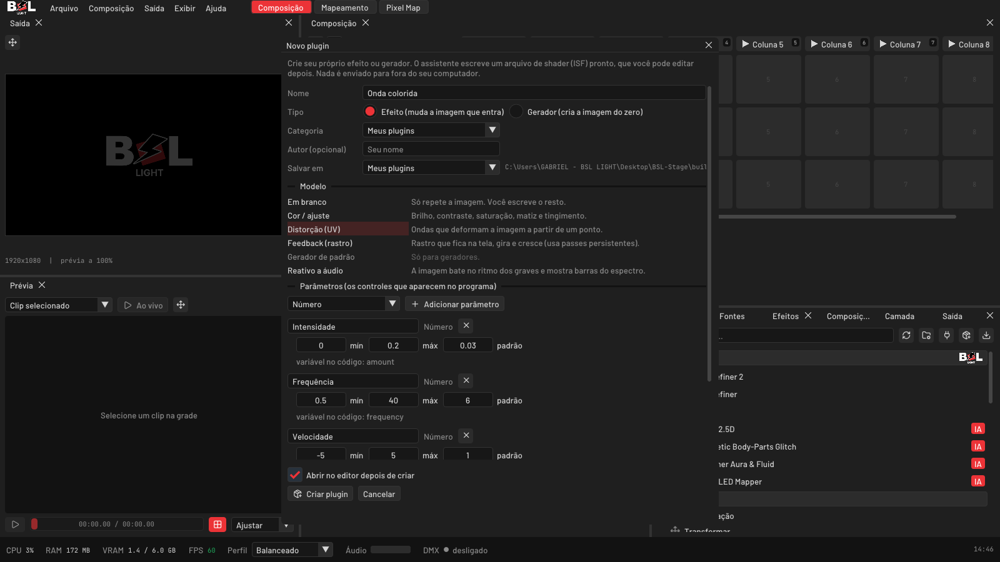

# Guia ISF: do zero ao primeiro plugin

Neste guia você cria três plugins de verdade, cada um um pouco mais complexo que o anterior. Não precisa saber programar para os dois primeiros: é copiar, salvar e mexer nos números.
No fim você vai saber ler e alterar qualquer shader ISF.

Os três exemplos estão prontos, com o mesmo texto deste guia, em `docs/plugins/exemplos/`. O teste `bslstage_plugintest` compila cada bloco de código deste arquivo, então o que está aqui funciona.

## O que é um plugin ISF

Um arquivo de texto com a extensão `.fs`. Ele tem duas partes:

1. **O cabeçalho** (entre `/*{` e `}*/`): diz o nome dos controles que vão aparecer no programa (sliders, cores, botões...).
2. **O código** (`void main() { ... }`): em GLSL, a linguagem das placas de vídeo. Ele roda **uma vez para cada pixel** da imagem e decide a cor daquele pixel.

Existem dois tipos:

- **Efeito**: recebe a imagem de um clip ou camada (`inputImage`) e devolve outra imagem.
- **Gerador**: não recebe nada e cria a imagem do zero.

## Caminho mais curto: o assistente

1. Na aba **Efeitos**, clique no ícone de pacote com mais (**Novo plugin…**), ou use **Arquivo > Novo plugin…**.
2. Escreva o nome, escolha **Efeito** ou **Gerador**, a categoria e um modelo. Ajuste os parâmetros se quiser.
3. Clique em **Criar plugin**. O arquivo `.fs` é gravado em `Documents\BSL Stage\Plugins` e o plugin aparece na hora na aba Efeitos (ou na aba Fontes, se for gerador).
4. Clique em **Abrir no editor**, mude o código, salve (`Ctrl+S`). Em um ou dois segundos o efeito recompila sozinho. Os valores que você ajustou nos controles continuam.

Se você errar, o painel do efeito mostra a mensagem com a **linha** do erro e o efeito continua funcionando com a versão anterior até você corrigir.



Os botões **Abrir no editor**, **Mostrar na pasta** e **Duplicar plugin** aparecem no efeito, dentro da cadeia (abra o efeito clicando no nome). O botão direito sobre um plugin ISF na
aba Efeitos abre o mesmo menu e mais **Exportar .bslplugin…**.

Quer escrever tudo do zero, sem o assistente? Crie um arquivo `.fs` em `Documents\BSL Stage\Plugins` e siga os exemplos abaixo.

## Exemplo 1: Tingimento (efeito simples)

Um efeito que pinta a imagem com uma cor escolhida, mantendo luz e sombra. Dois controles: uma cor e uma quantidade.

Crie `Tingimento.fs` com este conteúdo:

```
/*{
    "DESCRIPTION": "Tinge a imagem com uma cor, mantendo a luz e a sombra originais.",
    "CREDIT": "Exemplo do BSL Stage (CC0)",
    "ISFVSN": "2.0",
    "CATEGORIES": ["Color Effect"],
    "INPUTS": [
        { "NAME": "inputImage", "TYPE": "image" },
        { "NAME": "cor", "LABEL": "Cor do tingimento", "TYPE": "color", "DEFAULT": [1.0, 0.45, 0.1, 1.0] },
        { "NAME": "quantidade", "LABEL": "Quantidade", "TYPE": "float", "DEFAULT": 0.6, "MIN": 0.0, "MAX": 1.0 }
    ]
}*/

void main()
{
    vec4 src = IMG_THIS_NORM_PIXEL(inputImage);
    float luz = dot(src.rgb, vec3(0.2126, 0.7152, 0.0722));
    vec3 tingido = cor.rgb * luz * 1.5;
    gl_FragColor = vec4(mix(src.rgb, tingido, quantidade), src.a);
}
```

Como ler:

- `"CATEGORIES": ["Color Effect"]` coloca o plugin no grupo **Cor** da aba Efeitos.
- `inputImage` é obrigatório em um efeito: é a imagem que chega.
- `cor` e `quantidade` viram variáveis no código com exatamente esses nomes. Nada de declarar nada: o programa já fez.
- `IMG_THIS_NORM_PIXEL(inputImage)` devolve a cor da imagem de entrada **no pixel que está sendo desenhado**. É um `vec4` com vermelho, verde, azul e alfa (transparência).
- `.rgb` pega só as três cores; `.a` é a transparência.
- `dot(src.rgb, vec3(0.2126, 0.7152, 0.0722))` calcula o brilho do pixel (os três números são o peso de cada cor para o olho humano).
- `mix(a, b, t)` mistura `a` e `b`: com `t` = 0 dá `a`, com `t` = 1 dá `b`.
- `gl_FragColor` é a **saída**: a cor final deste pixel. Mantemos `src.a` para não estragar a transparência da imagem.

Teste: arraste **Tingimento** para um clip. Mexa na quantidade. Mude `1.5` para `2.0` no arquivo, salve, e veja a imagem clarear sem fechar nada.

## Exemplo 2: Plasma (gerador animado)

Um gerador não tem `inputImage`. Ele usa `TIME` (segundos) para se mover e `isf_FragNormCoord` (a posição do pixel, de 0 a 1) para saber onde está.

```
/*{
    "DESCRIPTION": "Plasma colorido que se move, com duas cores, velocidade, tamanho das manchas e centro.",
    "CREDIT": "Exemplo do BSL Stage (CC0)",
    "ISFVSN": "2.0",
    "CATEGORIES": ["Generator"],
    "INPUTS": [
        { "NAME": "corA", "LABEL": "Cor A", "TYPE": "color", "DEFAULT": [0.1, 0.2, 0.9, 1.0] },
        { "NAME": "corB", "LABEL": "Cor B", "TYPE": "color", "DEFAULT": [1.0, 0.2, 0.6, 1.0] },
        { "NAME": "velocidade", "LABEL": "Velocidade", "TYPE": "float", "DEFAULT": 1.0, "MIN": 0.0, "MAX": 4.0 },
        { "NAME": "escala", "LABEL": "Tamanho das manchas", "TYPE": "float", "DEFAULT": 3.0, "MIN": 0.5, "MAX": 12.0 },
        { "NAME": "centro", "LABEL": "Centro (px em 1920x1080)", "TYPE": "point2D", "DEFAULT": [960.0, 540.0], "MIN": [0.0, 0.0], "MAX": [1920.0, 1080.0] },
        { "NAME": "suave", "LABEL": "Suavizar", "TYPE": "bool", "DEFAULT": true }
    ]
}*/

void main()
{
    float aspect = RENDERSIZE.x / RENDERSIZE.y;
    vec2 c = centro / vec2(1920.0, 1080.0);
    vec2 p = (isf_FragNormCoord - c) * vec2(aspect, 1.0) * escala;
    float t = TIME * velocidade;
    float v = sin(p.x + t)
            + sin(p.y * 1.3 - t * 0.7)
            + sin((p.x + p.y) * 0.8 + t * 0.5)
            + sin(length(p) * 1.5 - t);
    v = clamp(v * 0.25 + 0.5, 0.0, 1.0);
    if (!suave)
        v = step(0.5, v);
    gl_FragColor = vec4(mix(corA.rgb, corB.rgb, v), 1.0);
}
```

Novidades:

- Sem `inputImage`, o arquivo é um **gerador**. Ele aparece na aba **Fontes**, seção ISF, e você arrasta para uma célula da grade.
- `point2D` é um ponto em **pixels**. Como o tamanho da tela pode mudar, dividimos por `vec2(1920.0, 1080.0)` para voltar a 0..1.
- `RENDERSIZE` é o tamanho da imagem. `aspect` (largura dividida pela altura) evita que as manchas fiquem esticadas.
- `bool` vira uma caixa de seleção; `if (!suave)` usa o valor.
- O `1.0` no fim de `vec4(..., 1.0)` é o alfa: 1 é totalmente opaco. Um gerador que esqueça o alfa pode sair transparente.

Teste: mude `sin(length(p) * 1.5 - t)` para `sin(length(p) * 4.0 - t)` e salve.

## Exemplo 3: Rastro (passes com memória)

Alguns efeitos precisam lembrar do quadro anterior (rastros, fumaça, eco). No ISF isso se faz com **passes** e um **buffer persistente**:

```
/*{
    "DESCRIPTION": "Rastro luminoso: cada quadro é desenhado sobre o anterior, que vai se apagando. Usa um buffer persistente (passe com memória).",
    "CREDIT": "Exemplo do BSL Stage (CC0)",
    "ISFVSN": "2.0",
    "CATEGORIES": ["Feedback"],
    "INPUTS": [
        { "NAME": "inputImage", "TYPE": "image" },
        { "NAME": "persistencia", "LABEL": "Persistência", "TYPE": "float", "DEFAULT": 0.9, "MIN": 0.0, "MAX": 0.99 },
        { "NAME": "crescer", "LABEL": "Crescimento do rastro", "TYPE": "float", "DEFAULT": 1.01, "MIN": 0.95, "MAX": 1.08 },
        { "NAME": "limpar", "LABEL": "Limpar rastro", "TYPE": "event" }
    ],
    "PASSES": [
        { "TARGET": "rastro", "PERSISTENT": true, "FLOAT": true },
        { }
    ]
}*/

void main()
{
    vec2 uv = isf_FragNormCoord;
    if (PASSINDEX == 0) {
        vec4 src = IMG_THIS_NORM_PIXEL(inputImage);
        vec4 novo = vec4(src.rgb * src.a, src.a);
        vec2 p = (uv - 0.5) / crescer + 0.5;
        vec4 antigo = IMG_NORM_PIXEL(rastro, p) * persistencia;
        vec4 saida = novo + antigo * (1.0 - novo.a);
        if (limpar)
            saida = novo;
        gl_FragColor = saida;
    } else {
        vec4 t = IMG_THIS_NORM_PIXEL(rastro);
        float a = min(t.a, 1.0);
        gl_FragColor = a > 0.0 ? vec4(min(t.rgb / a, vec3(1.0)), a) : vec4(0.0);
    }
}
```

Como funciona:

- `"PASSES"` tem dois itens, então o `main()` roda duas vezes por quadro. `PASSINDEX` diz qual (0 e 1).
- O passe 0 grava no buffer chamado `rastro`. `PERSISTENT: true` faz o buffer **sobreviver** ao próximo quadro: quando o passe 0 lê `rastro`, ele vê o quadro anterior.
- Ele lê o quadro anterior um pouquinho maior (`/ crescer`) e mais fraco (`* persistencia`), e desenha a imagem nova por cima. Esse é o rastro.
- `FLOAT: true` faz o buffer guardar números com mais precisão (e pesa mais).
- O passe 1 (o último) copia o buffer para a saída. Dentro do buffer a cor fica multiplicada pelo alfa ("pré-multiplicada"); na saída dividimos de volta, porque o programa espera alfa reto (explicação em `boas-praticas.md`).
- `limpar` é um `event`: um botão. Ele vale `true` por um quadro depois do clique.

## Como testar sem abrir o programa

O programa tem um validador de linha de comando que compila o shader do mesmo jeito que o aplicativo, diz o erro com a linha e pode salvar uma imagem:

```
bslstage_isfcheck Tingimento.fs --png previa.png
bslstage_isfcheck Plasma.fs --png previa.png --time 3
```

Abra `previa.png` para ver o resultado. Em efeitos, a imagem de entrada é uma cartela de teste (quatro quadrantes coloridos com grade); use `--input minha-foto.png` para usar outra.
`--set nome=valor` muda um parâmetro (`--set cor=1,0,0,1`). Mais opções em `PARA-IA.md`.

## Erros comuns de iniciante

| Sintoma | Causa e conserto |
|---|---|
| "Cabeçalho JSON inválido na linha N" | Falta ou sobra uma vírgula no cabeçalho, ou uma aspa. O último item de uma lista não leva vírgula. |
| "Linha N: undefined variable" | O nome no código não é igual ao `NAME` do cabeçalho (maiúsculas contam). |
| "Linha N: ... redefinition" | Você declarou algo que o programa já declara (`uniform`, `TIME`...). Apague a sua declaração. |
| O efeito só mostra preto | Esqueceu de escrever em `gl_FragColor`, ou o alfa é 0. Em gerador, termine com `, 1.0)`. |
| O efeito não faz nada | O código não lê `inputImage`. |
| A imagem aparece de cabeça para baixo | Você inverteu `y`: em ISF `y = 0` é a base. Nunca precisa inverter. |
| Um controle não aparece | `NAME` com acento ou espaço, ou `TYPE` escrito errado (`float`, `bool`, `long`, `color`, `point2D`, `event`, `image`, `audioFFT`). |

## Próximos passos

- Todos os tipos de controle e tudo o que o programa suporta: `ISF-referencia.md`.
- Deixar leve para PC fraco: `boas-praticas.md`.
- Compartilhar com outras pessoas: **Exportar .bslplugin…** e `licencas.md`.
- Precisa de C++ (mais desempenho, acesso a bibliotecas)? `FFGL-guia.md`.
