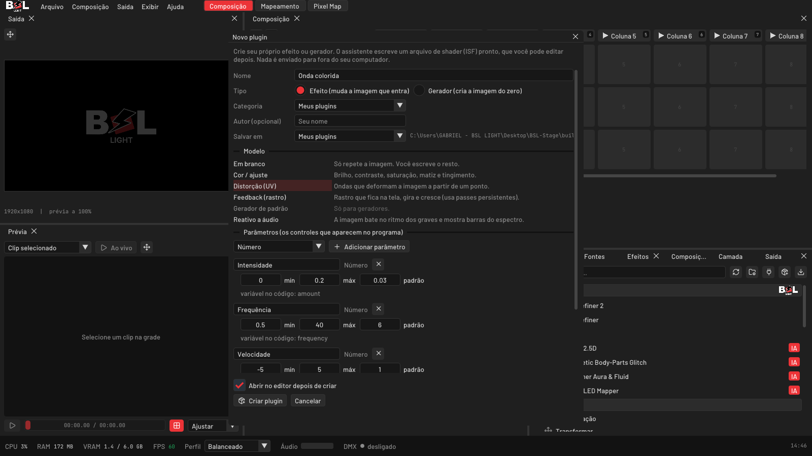

# Plugins do BSL Stage

O cliente cria o próprio plugin do jeito que quiser, sem esperar por ninguém. Há dois caminhos, ambos baseados em **padrões abertos**.

| | **ISF** (recomendado) | **FFGL 2.x** |
|---|---|---|
| O que é | Um arquivo de texto `.fs`: cabeçalho JSON + shader GLSL | Uma DLL de 64 bits escrita em C++ |
| Dificuldade | Baixa: dá para criar sem programar, pelo assistente | Média/alta: precisa de Visual Studio e CMake |
| Serve para | Efeitos e geradores visuais, reativos ao áudio, com rastros | Tudo o que o ISF faz, mais bibliotecas externas, geometria, leitura de arquivos, cálculo no CPU |
| Atualizar | Salvou o arquivo, recompila sozinho, sem perder os valores | Recompilar e trocar a DLL (fechar o programa) |
| Segurança | Não executa código: só desenha na placa de vídeo | É um programa: o BSL Stage isola, mas instale só o que for confiável |
| Documentação | `ISF-guia.md`, `ISF-referencia.md` | `FFGL-guia.md`, `sdk/ffgl-template/` |

**Qual escolher?** Comece pelo ISF. Só passe para o FFGL se o ISF não conseguir fazer o que você precisa.

## Compatibilidade com plugins de outros lugares

O BSL Stage fala os dois padrões abertos. Qualquer **shader ISF** e qualquer **plugin FFGL 2.x de 64 bits** que respeite o padrão pode ser usado, seja de quem for. Para isso o programa:

- lê e executa os arquivos pelo padrão (o código do leitor e do host foi escrito do zero, a partir das especificações públicas);
- **não copia, não converte nem redistribui** plugins de terceiros: cada pessoa instala o que tem direito de usar, e a licença de cada um continua valendo (`licencas.md`).

## Criar um plugin pelo programa

1. Aba **Efeitos**, ícone **Novo plugin…** (ou menu **Arquivo > Novo plugin…**).
2. Nome, tipo (efeito ou gerador), categoria, modelo e parâmetros (número, cor, liga/desliga, ponto 2D, imagem, botão e áudio).
3. **Criar plugin**: o arquivo `.fs` vai para `Documents\BSL Stage\Plugins` e aparece na hora na aba Efeitos.
4. **Abrir no editor** (usa o editor de código instalado, se houver, ou o Bloco de Notas), altere e salve. O efeito recompila sozinho. Erro de compilação: o painel do efeito mostra a linha e a versão anterior continua rodando.
5. Na aba Efeitos, botão direito sobre um plugin ISF: **Abrir no editor**, **Mostrar na pasta**, **Duplicar** e **Exportar .bslplugin…**.



## Compartilhar: o pacote `.bslplugin`

Um `.bslplugin` é um ZIP com o `.fs`, as imagens que ele usa e um `manifest.json` (nome, autor, versão, licença, descrição).

- **Exportar**: botão direito sobre o plugin > **Exportar .bslplugin…**.
- **Importar**: **Arquivo > Importar plugin (.bslplugin)…**, o ícone de download da aba Efeitos, ou arraste o arquivo para a janela do programa. Antes de instalar o programa mostra nome, autor, versão e a **licença**, e só instala depois do seu aceite.
- O importador recusa caminhos suspeitos, arquivos que não sejam shader, imagem ou texto (programas, DLLs, scripts) e pacotes de tamanho absurdo. Nada é gravado em caso de recusa.

## Mapa dos documentos

| Arquivo | Conteúdo |
|---|---|
| `ISF-guia.md` | Tutorial passo a passo com três exemplos completos |
| `ISF-referencia.md` | Todos os tipos de entrada, variáveis, passes e o que o BSL Stage suporta ou não |
| `FFGL-guia.md` | Plugins em C++ e o modelo `sdk/ffgl-template` |
| `boas-praticas.md` | Desempenho em PC fraco, precisão, alfa, laços |
| `licencas.md` | Publicar, escolher licença, não usar código de terceiros sem permissão |
| `PARA-IA.md` | Documento para uma IA criar plugins a partir do pedido do cliente |
| `exemplos/` | Os exemplos do guia, prontos para copiar |

Para IAs: `AGENTS.md` na raiz do repositório e a skill `skills/bsl-stage-plugin/`.

## Validador de linha de comando

`bslstage_isfcheck <arquivo.fs>` compila o shader com o mesmo leitor e host do aplicativo, mostra os erros com a linha e um resumo dos parâmetros, e pode salvar uma prévia:

```
bslstage_isfcheck Meu.fs --png previa.png --time 1.5
```

Todas as opções estão em `PARA-IA.md`.
